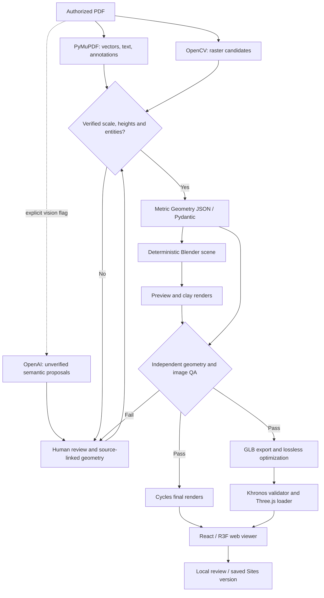

# Architecture and contracts

## Authoritative source

`pipelines/pdf/extract.py` records the PDF SHA-256, all pages, text blocks and dimensions, vector paths (including curves), annotations and rasterized evidence. OpenCV Canny/Hough produces line candidates for scans. Raster candidates have no verified scale or architectural semantics. Extraction limits files to 50 MiB and 50 pages and rejects encrypted/oversized pages.

`normalize.py` supports the explicitly annotated synthetic test convention. Each label must match one actual drawn rectangle, and the visible 10 m calibration must agree with the printed 1:50 scale. No fixture dimensions are imported into the parser. Other drawings stop at `ReviewRequired` and can enter modeling only through human-reviewed geometry.

`vision.py` uses Responses structured parsing, PDF file input and `store=False`. It runs only with `--vision`. The content is treated as data, and all responses remain inferred observations. A missing key is actionable; there is no fake API fallback.

## Typed geometry v1

`Geometry` specifies metric units, PDF coordinate transformation, floors/elevations, polygonal walls, doors/windows, rooms, slabs, roofs, outdoor areas, verified measurements, uncertainties and missing information. Every architectural object has a stable ID, floor and evidence (page, original coordinates, primitive, status, confidence). Pydantic/Shapely reject invalid polygons, unknown host walls, overlapping walls, duplicate IDs and inconsistent calibration. A strict gate rejects inferred/missing entities. `source_check` verifies the source digest and the metric transformation of every polygon vertex.

The initial transform is a common scale/origin for all pages. Multi-page projects with different scales/rotations require preprocessing or a future per-page transform schema. Arbitrary semantics are not automatically certified.

## Deterministic Blender

`build_scene.py` uses factory startup, metres and scale 1. Polygon extrusion triangulates caps; exact boolean cutters remove door/window openings. Doors and glass are separate, source-linked solids. Rooms are organization empties; no furniture or unspecified structural elements are added. Roofs and outdoor slabs are generated only when present in the schema. Scene collections separate architecture from studio ground, cameras and lighting.

The same `scene.blend` supplies previews, finals and GLB. Geometry hash and passing QA are checked before final export. Cycles seed 42, materials, sampling, resolution and selected device are recorded in `render-config.json`. Automatic Metal/CUDA/etc selection falls back to CPU; explicitly requesting unavailable GPU fails. Render presets are clay, preview and final. Interior camera positioning currently assumes a rectangular room; complex room shapes need reviewed camera placement.

## Independent quality gate

Blender exports evaluated world-space vertices/triangles, not only object dimensions. QA independently recomputes bounds, signed volume, normals/winding, edge manifoldness, polygon projections and host-wall void samples. Overall footprint and orthographic render masks are compared against source geometry, with a default 2 mm metric tolerance. Image checks detect flat/abnormal exposure, and top-view mask checks framing. These are geometric and exposure checks, not an aesthetic score or a general collision solver.

## Transaction and web export

`pipelines.run` creates a fresh `.run-*` directory for each attempt. Failed runs retain evidence and set `run-status.json` to failed; previously delivered files are not treated as the new success. All final artifacts replace the prior generation only after geometry/render QA and GLB validation pass. Provenance records hashes of PDF, schema, code files, lockfiles, rendering settings and generated artifacts.

Blender exports glTF 2.0 with extras and metre-scale Y-up conversion. glTF Transform performs lossless resource deduplication, preserving node names, metadata, hierarchy and transforms; no mesh simplification or quantization. Khronos glTF Validator and Three.js GLTFLoader independently load the model. Procedural materials require no external texture fetches.

`site/public/project/manifest.json` describes model, renders, floors, source digest, bounds and QA status. Paths are relative to Vite BASE_URL. React loads the manifest, lazily loads WebGL and provides camera/floor/visibility controls, gallery and retry states. Static hosting is sufficient; no database or server is required.

MCP is isolated optional development tooling. See [BLENDER_MCP.md](BLENDER_MCP.md). Production regeneration never requires a GUI or MCP connection.
