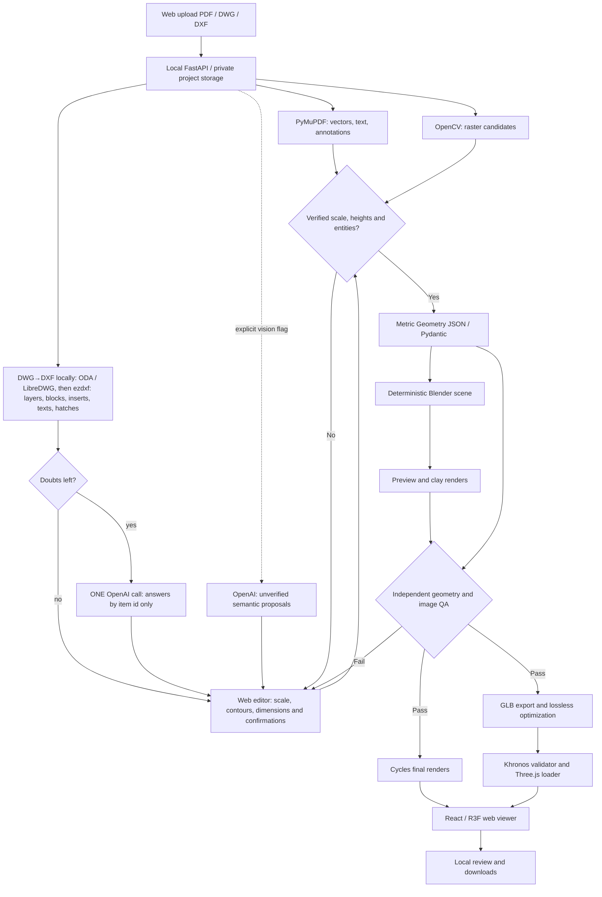

# Architecture and contracts

## Authoritative source

**Decision: the uploaded source drawing (PDF or DWG/DXF) is authoritative.** It replaces "the PDF is authoritative". The reason is unchanged: geometry must come from what the architect drew, never from a model's guess. A DWG holds that drawing more precisely than a PDF export does: true coordinates in declared units, named layers, block references with insertion point, rotation and mirroring, and handles that make every element traceable. So the DWG gets the same authority and the same rules. Dimensions are never invented. Units are taken from `$INSUNITS` or inferred, and the inference is always recorded and shown. Whatever the drawing does not settle stops at review as *missing*. Verified (read from the drawing), inferred (resolved by the AI) and user-answered readings are kept apart down to the Geometry evidence. Provenance is the PDF page and coordinates, or for CAD the DXF handles, layers, block name, converter and version, and the file's SHA-256.

`pipelines/pdf/extract.py` records the PDF SHA-256, all pages, text blocks and dimensions, vector paths (including curves), annotations and rasterized evidence. OpenCV Canny/Hough produces line candidates for scans. Raster candidates have no verified scale or architectural semantics. Extraction limits files to 50 MiB and 50 pages and rejects encrypted/oversized pages.

`normalize.py` supports the explicitly annotated synthetic test convention. Each label must match one actual drawn rectangle, and the visible 10 m calibration must agree with the printed 1:50 scale. No fixture dimensions are imported into the parser. Other drawings stop at `ReviewRequired` and can enter modeling only through human-reviewed geometry.

`vision.py` uses Responses structured parsing, PDF file input and `store=False`. It runs only with `--vision`. The content is treated as data, and all responses remain inferred observations. A missing key is actionable; there is no fake API fallback.

## DWG / DXF source

`pipelines/cad/convert.py` converts a DWG on this machine: ODA File Converter is preferred and LibreDWG `dwg2dxf` is accepted. It never uses a cloud converter. A DXF is read directly. `pipelines/cad/read.py` reads model space only with ezdxf; layouts and paper space are ignored, and title blocks are excluded by position.

- **Plans.** Wall geometry is clustered into separate drawn plans. If there are several, the user picks one.
- **Walls.** Cut hatches, closed outlines and parallel line pairs on wall layers, kept only if thinner than 0.6 m. Floor hatches on the same layers are wider and so are excluded.
- **Openings.** Gaps between facing wall ends with free space on both faces, so niches are excluded. The kind comes from door/window block or layer names. The hinge side comes from the arc. Stacked gaps from stepped jambs are merged.
- **Furniture.** Block inserts, with dynamic-block names resolved. The footprint is the visible geometry in the insert frame. The back is checked against the walls with the side rule of each kind.
- **Rooms.** Spaces enclosed by walls and openings, named by the TEXT/MTEXT inside them. Finishes come from hatch patterns.

Naming conventions are in `pipelines/cad/config.py`. Layer names match by pattern or by near spelling, and the match is recorded. Every layer of the drawing is inventoried and shown in the review: its role, how it matched, whether it is off or frozen, its contents and its use. Off, frozen and demolition layers are never read. Bed and sofa blocks that also draw nightstands, a rug or a table are split into their drawn pieces; an L-sofa becomes modules facing into the L, and the extra pieces are classified by the AI.

`pipelines/web/dwg.py` sends only the unresolved items: unknown blocks, unclear fronts, unnamed carpentry in a gap, orphan openings, unnamed rooms, layers that may be walls, and unknown hatch patterns. They go as compact JSON plus a labelled 1024 px image of the plan, in **one** `responses.parse` call. The call uses a strict schema whose answers reference item ids only, `reasoning.effort = "medium"` and `store=False`. It is cached by model, prompt version and payload hash, and audited in `ai-audit/`. If there are no doubts, no call is made. If the key is missing or the call fails, the deterministic reading is kept and the items stay pending for the user. Approval is blocked while blocking items are pending.

The review sheet is the plan rendered locally, in centimetres with y down, so the existing review UI and `validate_draft` work unchanged. `Source.format`/`converter` and `Evidence.cad` (`CadReference`) carry the provenance into `Geometry`, the run status, provenance and the manifest. `pipelines.run` re-hashes the DWG before Blender runs.

## Typed geometry v1

`Geometry` specifies metric units, PDF coordinate transformation, floors/elevations, polygonal walls, doors/windows, rooms, slabs, roofs, outdoor areas, verified measurements, uncertainties and missing information. Every architectural object has a stable ID, floor and evidence (page, original coordinates, primitive, status, confidence). Pydantic/Shapely reject invalid polygons, unknown host walls, overlapping walls, duplicate IDs and inconsistent calibration. A strict gate rejects inferred/missing entities. `source_check` verifies the source digest and the metric transformation of every polygon vertex.

The initial transform is a common scale/origin for all pages. Multi-page projects with different scales/rotations require preprocessing or a future per-page transform schema. Arbitrary semantics are not automatically certified.

## Deterministic Blender

`build_scene.py` uses factory startup, metres and scale 1. Polygon extrusion triangulates caps; exact boolean cutters remove door/window openings. Doors and glass are separate, source-linked solids. Rooms are organization empties; no furniture or unspecified structural elements are added. Roofs and outdoor slabs are generated only when present in the schema. Scene collections separate architecture from studio ground, cameras and lighting.

The same `scene.blend` supplies previews, finals and GLB. Geometry hash and passing QA are checked before final export. Cycles seed 42, materials, sampling, resolution and selected device are recorded in `render-config.json`. Automatic Metal/CUDA/etc selection falls back to CPU; explicitly requesting unavailable GPU fails. Render presets are clay, preview and final. Interior camera positioning currently assumes a rectangular room; complex room shapes need reviewed camera placement.

## Independent quality gate

Blender exports evaluated world-space vertices/triangles, not only object dimensions. QA independently recomputes bounds, signed volume, normals/winding, edge manifoldness, polygon projections and host-wall void samples. Overall footprint and orthographic render masks are compared against source geometry, with a default 2 mm metric tolerance. Image checks detect flat/abnormal exposure, and top-view mask checks framing. These are geometric and exposure checks, not an aesthetic score or a general collision solver.

## Transaction and web export

`pipelines.run` creates a fresh `.run-*` directory for each attempt. Failed runs retain evidence and set `run-status.json` to failed; previously delivered files are not treated as the new success. All final artifacts replace the prior generation only after geometry/render QA and GLB validation pass. Provenance records hashes of PDF, schema, code files, lockfiles, rendering settings and generated artifacts.

Blender exports glTF 2.0 with extras and metre-scale Y-up conversion. glTF Transform performs lossless resource deduplication, preserving node names, metadata, hierarchy and transforms; no mesh simplification or quantization. Khronos glTF Validator and Three.js GLTFLoader independently load the model. Procedural materials require no external texture fetches.

`site/public/project/manifest.json` describes model, renders, floors, source digest, bounds and QA status. Paths are relative to Vite BASE_URL. React loads the manifest, lazily loads WebGL and provides camera/floor/visibility controls, gallery and retry states. Static hosting is sufficient for the presentation viewer only. The PDF workflow requires the local Python server and Blender.

MCP is isolated optional development tooling. See [BLENDER_MCP.md](BLENDER_MCP.md). Production regeneration never requires a GUI or MCP connection.

## Local web orchestration

`pipelines/web/server.py` serves the production React build and same-origin `/api` routes on 127.0.0.1. Upload → extraction → review → queued → running → succeeded/failed. A single background worker controls Blender. JSON project state, evidence, drafts and isolated run directories live in `outputs/web-projects`; no external database or cloud processing is used.

`review.py` validates a typed page/scale/floor/entity draft and builds the source-linked metric schema only after explicit confirmation. General PDFs start with unknown measurements; actual vector rectangles are selectable candidates. The editor supports manual polygons over vector or scanned pages, numeric coordinates and per-element properties. Currently one page and floor per project, up to 300 entities and 200 vertices per entity. Openings must span their host wall thickness; rectangular wall thickness must agree with the calibrated contour.

API routes: POST `/api/projects` (multipart PDF), GET `/api/projects` and `/{id}`, PUT `/{id}/draft`, POST `/{id}/validate`, POST `/{id}/generate`, GET `/{id}/files/{allowed-artifact}`. Mutations carry a revision; stale writes and duplicate jobs return 409. Generation freezes the approved revision. Only a successful current revision exposes its final manifest and assets, with a per-run URL token to invalidate GLB caches. Failed jobs retain evidence and can be retried. Startup marks interrupted jobs for review.

Host/Origin checks reject cross-site and DNS rebinding requests. Body limits apply before parsing; filenames never choose storage paths, random project IDs and explicit artifact allowlists prevent arbitrary file access. The web flow never enables the optional vision API. Source PDFs remain local and generated artifacts are ignored by Git.

The orthographic QA reference samples pixel centres. The rendered mask uses linear Raw output with denoising disabled to avoid display-gamma/denoising edge expansion; metric mesh checks retain their 2 mm tolerance and mask IoU retains the 0.90 threshold.
